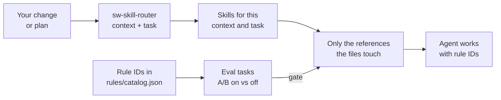

# ai-skills-shopware

Agent Skills for Shopware 6 that are tested, not assumed. They teach Claude
Code, Cursor, Codex and OpenCode what a general model gets wrong about
Shopware. Each rule has an ID and an eval, and the router loads only what your
change needs.

## Why use it

General models write plausible Shopware code for the wrong version. They
subscribe to events core stopped dispatching, guard on classes whose methods
arrived a minor release later, and register services the 6.8 way in a 6.6
plugin. Most skill sets add more text. This one measures what the text does.

- **Proven per rule.** Every rule has an ID such as `PLG-007` and an eval
  task. An A/B run with the skills on and off shows whether the rule changes
  the result. A gate blocks a release when a rule makes things worse.
- **Version facts, not guesses.** A public API index of every release since
  6.5 tells the review what exists, what is deprecated and what changed in
  your `composer.json` range.
- **Lean context.** References load by the files you change. `/sw-skill-router`
  tells you, and your agent, which skills a diff or a plan needs.
- **Built for the real surfaces.** Core, plugins, apps, shop projects,
  Storefront and Administration each get their own rules. The router detects
  which one you are in.
- **Kept current.** A weekly job reports what changed on Shopware trunk, and
  the API index rebuilds weekly.

## Results

From A/B runs with Claude Haiku, graded by scripts:

| Planted problem | Skills off | Skills on |
| --------------- | ---------- | --------- |
| A 6.7 subscriber to a cache-tags event core no longer dispatches (`PLG-007`) | 0/3 | 3/3 |
| A storefront form that still uses `sw_csrf` (`SF-009`) | 0/3 | 3/3 |
| One Admin bundle for 6.5 and 6.6+ binding form fields the old way (`ADM-044`) | 0/3 | 3/3 |
| Version-guard mistakes with API no skill names, rules alone vs rules plus `api-facts` | 5/15 | 15/15 |

No clean twin task got more false findings with the skills on. The full
numbers are in [`docs/results.md`](docs/results.md), including where the
skills made no difference.

## Quick start

Start with the two skills that help you find the rest:

```bash
npx skills add BrocksiNet/ai-skills-shopware \
  --skill sw-skill-router --skill sw-help \
  -a claude-code -a cursor -a codex
```

Then, in your agent:

- `/sw-help` shows what every skill is for, with example prompts.
- `/sw-skill-router` reads your branch, detects core, plugin, app or project,
  and lists the skills and references to load. It prints the install command
  for any that are missing.

To install the full set for your kind of work, pick one of the use-case
pages:
[plugins](use-cases/plugin-development.md),
[apps](use-cases/app-development.md),
[core](use-cases/core-development.md),
[Storefront and Administration](use-cases/storefront-development.md), or
[extension review](use-cases/extension-review.md).
Pinning, updating and tool folders are covered in
[`docs/installation.md`](docs/installation.md).

## What is inside

| You want to | Skills |
| ----------- | ------ |
| Build | `sw-plugin-development`, `sw-app-development`, `sw-core-development`, `sw-admin-js`, `sw-storefront`, `sw-php-foundation`, `sw-testing`, `sw-security`, `sw-architecture` |
| Ship | `sw-change-impact`, `sw-pr-description` |
| Review | `sw-extension-review`, `sw-review-learnings`, `sw-pr-review` |
| Run, research, answer | `sw-podman-dev`, `sw-research-and-escalation`, `sw-assistant-style` |
| Find your way | `sw-skill-router`, `sw-help` |

[`REGISTRY.md`](REGISTRY.md) lists what each skill owns. Every topic has
exactly one owner, so two skills never give conflicting advice.

## How it works



A skill is a short `SKILL.md`, references that hold the rules, and a
`routes.json` that maps changed files and lines to references. Review skills
borrow the topic skills' references instead of copying them, so a review
and its rule cannot drift apart. Diagrams and the eval layers are in
[`docs/architecture.md`](docs/architecture.md).

## Staying current

Weekly jobs report trunk changes to Shopware's own agent skills, guidelines
and PHPStan rules, and rebuild the API index for each new release. Model
evals run monthly and before releases. Next, the same weekly reports will
watch upstream skill sets such as `shopwareLabs/ai-coding-tools` and
`netresearch/php-modernization-skill`, plus a planned PHPUnit skill. See
[`docs/maintenance.md`](docs/maintenance.md).

## Documentation

| Doc | For |
| --- | --- |
| [`docs/installation.md`](docs/installation.md) | Install, pin, update, the `sw-` rename, where each tool loads skills |
| [`docs/architecture.md`](docs/architecture.md) | Parts, routing, the router, eval layers, version facts |
| [`docs/results.md`](docs/results.md) | What the A/B runs showed |
| [`docs/maintenance.md`](docs/maintenance.md) | Automation that keeps rules current, and what is planned |
| [`docs/skill-resolution.md`](docs/skill-resolution.md) | Core trunk's own skills next to ours |
| [`docs/local-validation.md`](docs/local-validation.md) | Try the skills on your own shop and send feedback |
| [`evals/README.md`](evals/README.md) | Writing and running eval tasks |
| [`AGENTS.md`](AGENTS.md) | Contributing: repo layout, checks, adding rules and skills |

## Curation & governance

This is a curated library. A rule gets in only when it meets all five tests:

1. **Delta.** The base model gets it wrong for Shopware. We do not re-teach
   generic PHP or Symfony.
2. **Value.** It maps to a recurring review finding or a high-impact area.
3. **Single home.** It belongs to exactly one skill, as the coverage matrix
   in [`REGISTRY.md`](REGISTRY.md) enforces.
4. **Testable.** It has an eval. A rule without one records why in
   [`rules/catalog.json`](rules/catalog.json), so the untested rules are a
   visible backlog.
5. **License-clean.** It is written in our own words. Upstream is
   inspiration: MIT content may be vendored as a pinned, attributed snapshot,
   and CC-BY-SA content is rewritten.

`sw-core-development` is maintainer-controlled. Propose changes by pull
request. Recurring findings from real reviews come in through the
[issue templates](.github/ISSUE_TEMPLATE) and become rules with eval tasks.
Maintainer rules from `shopware/shopware` are mined, not copied. See
[`docs/core-pr-17657-alignment.md`](docs/core-pr-17657-alignment.md).

## Credits

Built on, and rewritten from:
[`shopwareLabs/ai-coding-tools`](https://github.com/shopwareLabs/ai-coding-tools),
[`bartundmett/skills`](https://github.com/bartundmett/skills),
[`biotech-shopware/claude-shopware-skill`](https://github.com/biotech-shopware/claude-shopware-skill),
[`netresearch/php-modernization-skill`](https://github.com/netresearch/php-modernization-skill),
the [LambdaTest PHPUnit skill](https://github.com/LambdaTest/agent-skills),
and Shopware's own [`coding-guidelines`](https://github.com/shopware/shopware/tree/trunk/coding-guidelines).
Authoring follows [Anthropic's skill guide](https://www.anthropic.com/news/skills)
and the [skills.sh](https://github.com/vercel-labs/skills) ecosystem.

## License

[MIT](LICENSE).
