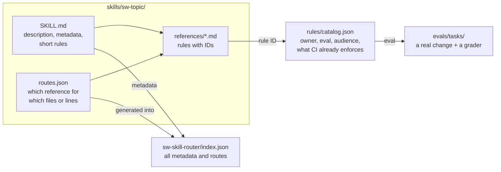
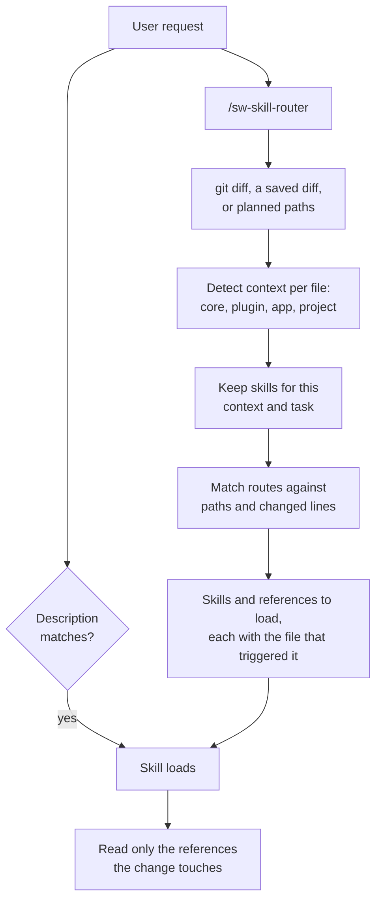
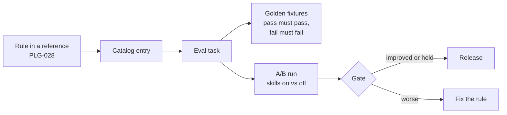

# Architecture

How the library is built, how an agent finds the right rule, and how every
push proves the rules still hold. Contributor workflow:
[`AGENTS.md`](../AGENTS.md). Ownership of every topic:
[`REGISTRY.md`](../REGISTRY.md).

## The parts



| Part | What it does |
| ---- | ------------ |
| `SKILL.md` | The description decides when the skill loads. The body stays short and links to references. The `metadata` block names the contexts (core, plugin, app, project) and tasks (build, review, ship, answer, run) it is for. |
| `references/*.md` | The rules, each starting with a bold ID such as `**PLG-028**`. An agent reads only the references the change needs. |
| `routes.json` | Globs on changed paths and regexes on changed lines that select a reference. The table in `SKILL.md` is generated from it. |
| `rules/catalog.json` | One entry per rule: the owning skill and file, its eval task or why it has none, its audience, and the CI check that already catches it. |
| `evals/tasks/` | A starting fixture, an instruction and a deterministic grader per rule, with golden pass and fail fixtures. |
| `sw-skill-router/index.json` | Every skill's metadata and resolved routes in one file, so the installed router needs nothing else. |

## How an agent finds the rule

Two paths lead to the same references. The agent's own skill matching uses
the descriptions. The router uses the diff.



The context filter is what keeps a plugin's `services.xml` from loading the
core rules. In a shop project, files under `custom/plugins/<name>/` count as
plugin and files under `custom/apps/<name>/` as app.

Review skills own no rules. `sw-extension-review` borrows the topic skills'
references through routes such as
`../sw-plugin-development/references/migrations.md` and takes their
triggers, so a review and the rule it cites cannot drift apart.

## How a rule is proven



| Layer | What runs | Cost | When |
| ----- | --------- | ---- | ---- |
| 0 | Skill structure and budgets, rule IDs against the catalog, routes and the router index, golden graders, ShellCheck, Markdown lint, tool tests | free | every push |
| 1 | Activation: does the right skill load for its trigger prompts, and stay quiet for others? | agent | dry on push, real in `evals.yml` |
| 2 | Behavior: the agent does a real task, and a grader checks the result with grep, AST or project tooling | agent | `evals.yml` |
| 3 | A/B: the same tasks with skills on and off | agent | monthly, on dispatch, or with the `run-evals` label |

Review rules come in pairs. A `-catch` task plants the problem, and the
findings must name the rule. An `-ignore` task looks similar but is clean, so
any finding fails. Near-miss tasks put a real problem next to a decoy rule and
fail a review that cites the decoy.

Results so far: [`results.md`](results.md). Running evals yourself:
[`evals/README.md`](../evals/README.md) and [`smoke-evals.md`](smoke-evals.md).

## Version facts

Many review wins turn on "this exists from that version". The model does not
know that, so [`tools/api-index/`](../tools/api-index/) builds a public API
index of every `shopware/shopware` release since 6.5.0.0:

| Tool | Answers |
| ---- | ------- |
| `api-facts` | Which Shopware API does this extension use that is missing, internal, deprecated or changed somewhere in its `composer.json` range? |
| `api-diff` | Does this change break public API: PHP, routes, entity fields, feature flags or configuration? |
| `check-breaks` | How well does `api-diff` find the breaks the UPGRADE files name? |

A weekly workflow rebuilds the index and publishes it as the `api-index`
release asset.

## Repository layout

```text
skills/<skill>/        SKILL.md, references/, routes.json, evals/ (activation prompts)
rules/catalog.json     every rule ID
evals/tasks/<task>/    instruction, fixture, golden fixtures, grade.sh
evals/routing/<case>/  a diff and the references it must select
tools/                 TypeScript tooling run by Node 24: validators, renderers, eval runner, graders
tools/api-index/       the public API index generator
use-cases/             install one-liners per kind of work
docs/                  this documentation
```
