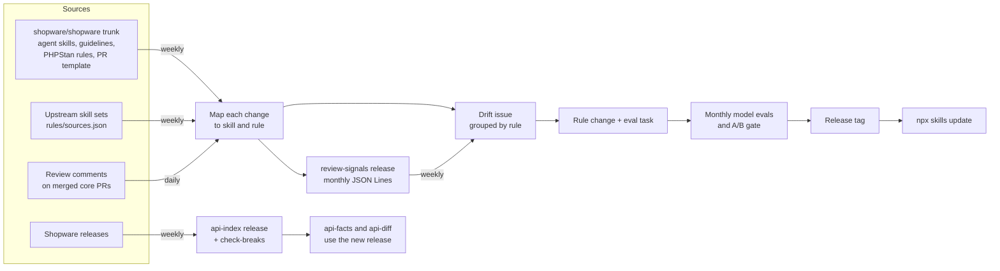

# Staying current

Shopware changes every week, so a rule that was right for 6.6 can be wrong
for 6.8. The library treats that as a maintenance job with automation, not a
one-time write-up.



The details live next to this page:

- [Drift and review signals](drift-and-reviews.md): reading the weekly drift
  issue, the review comments, replaying the router.
- [Suggesting rules](suggesting-rules.md): rule proposals, drafting one as a
  pull request, the CI workflow.
- [Releasing](releasing.md): cutting a release and writing its changelog entry.
- [Core skill alignment](core-pr-17657-alignment.md): the rule checklist
  mined from core trunk, with the open core PR watchlist.

## What runs today

| Job | When | What it does |
| --- | ---- | ------------ |
| Drift mining ([`mine-trunk.yml`](../../.github/workflows/mine-trunk.yml)) | weekly | Reads every source in [`rules/sources.json`](../../rules/sources.json) since its last pass, maps each change to the skill and rule it touches, and opens a `trunk-drift` issue grouped by skill and rule. A `/mined` comment from a member moves [`.mining-state.json`](../.mining-state.json) forward for every source. |
| Review collector ([`collect-reviews.yml`](../../.github/workflows/collect-reviews.yml)) | daily | Reads the review comments on PRs merged into `shopware/shopware` trunk since the last run, maps each to the skill and rule it touches, and publishes them as the `review-signals` release. See [Review comments](drift-and-reviews.md#review-comments). |
| API index ([`api-index.yml`](../../.github/workflows/api-index.yml)) | weekly | Rebuilds the public API index for every release since 6.5.0.0 plus trunk, publishes it as the `api-index` release asset, and runs `check-breaks` against the UPGRADE files. |
| Rule suggestions ([`suggest-rules.yml`](../../.github/workflows/suggest-rules.yml)) | weekly, after drift mining | Runs `suggest-rules` over the public review signals and the drift issue and posts the ranked proposals on that issue. A `/draft <ID>` comment from a member drafts one as a pull request. See [Suggesting rules in CI](suggesting-rules.md#suggesting-rules-in-ci). |
| Model evals ([`evals.yml`](../../.github/workflows/evals.yml)) | monthly, on dispatch, or with the `run-evals` label | Runs the A/B for the eval tasks and fails the gate when a skill makes results worse. |
| Core PR watchlist | with each mining pass | Open core PRs that will change a rule, with a prepared branch where it pays off. See [`core-pr-17657-alignment.md`](core-pr-17657-alignment.md#watchlist). |
| `scripts/check-update.sh` | when you run it | Tells an installed project that a newer release exists. |

Running drift mining locally:

```bash
node tools/bin/mine-trunk.ts report                       # every source since its state
node tools/bin/mine-trunk.ts report --source shopware     # one source
node tools/bin/mine-trunk.ts report --since 2026-10-13 --until 2026-10-19
node tools/bin/mine-trunk.ts report --signals drift.jsonl # also write the mapped changes
```

The `/mined` pull request needs **Settings → Actions → General → Workflow
permissions → "Allow GitHub Actions to create and approve pull requests"**.

## Sources

The drift job reads the repositories in
[`rules/sources.json`](../../rules/sources.json). Each one names the paths to
watch, how to read a commit, and which of our skills learn from which path.

| Source | What it reads | Our skills |
| ------ | ------------- | ---------- |
| `shopware` ([`shopware/shopware`](https://github.com/shopware/shopware) trunk) | Agent skill bullets, coding guideline headings, review guide rule IDs, PR template lines, PHPStan and Danger rule classes, the lines of the root, Administration and `.github` `AGENTS.md` files, the shared-guidance ADR and the environment templates, and rule settings in the Admin and Storefront ESLint, Stylelint and ludtwig configs | By path: core's agent skills map to ours, the PR template to `sw-pr-description`, the lint configs to `sw-admin-js` and `sw-storefront`; `ignore` leaves out the triage skills |
| `ai-coding-tools` ([`shopwareLabs/ai-coding-tools`](https://github.com/shopwareLabs/ai-coding-tools)) | Markdown bullets and headings in the test-writing, contributor-writing, code-migration and dev-tooling plugins | `sw-testing`, `sw-pr-description`, `sw-plugin-development`, `sw-local-dev` |
| `php-modernization` ([`netresearch/php-modernization-skill`](https://github.com/netresearch/php-modernization-skill)) | Markdown bullets and headings | `sw-php-foundation` |
| `shopware-cli` ([`shopware/shopware-cli`](https://github.com/shopware/shopware-cli)) | Markdown bullets and headings of its skills | `sw-local-dev` |
| `shopware-rector` ([`FriendsOfShopware/shopware-rector`](https://github.com/FriendsOfShopware/shopware-rector)) | README and documentation for rules, version sets and compatibility boundaries; rule implementations stay upstream | `sw-plugin-development` |
| `fos-agent-skills` ([`FriendsOfShopware/agent-skills`](https://github.com/FriendsOfShopware/agent-skills)) | Markdown bullets and headings | `sw-testing`, `sw-admin-js` |

A dedicated PHPUnit skill joins once it exists.

The `shopware` source also watches root `AGENTS.md` and the Administration
`AGENTS.md`. These files often state requirements in paragraphs, so their
changed prose lines are mined as well as bullets. Fenced code examples are
ignored. Root guidance falls back to the core, testing and Administration
skills; Administration guidance falls back to `sw-admin-js`. A source match
is a triage suggestion, not evidence that every rule in that skill applies.

To add a source:

1. Add an entry to `rules/sources.json`: `id`, `repo`, `branch`,
   `extractor` (`markdown` for a skill repository), the watched `paths`, and
   the `skills` per path. `validate-skills.sh` checks the file and the skill
   names.
2. Commit nothing else. The next report gives the new source a first pass
   that only records its branch head, and `/mined` stores it. Changes from
   then on show up in the weeks after.

A source `id` is a key in `.mining-state.json` and in the catalog, so it is
never renamed.

## How a change lands

1. A drift issue, a review finding or a user report names the change. When
   a rule comes from trunk or an upstream skill set, record where in the
   catalog (`trunk.source` or `upstream`, as `path#heading-anchor`), so the
   next drift issue files changes there under the rule.
2. The rule changes in its one owning skill (see [`REGISTRY.md`](../../REGISTRY.md)),
   with its ID and catalog entry. Either you write it, or `suggest-rules`
   proposes it and `suggest-rules draft` writes it into a draft PR.
3. An eval task proves it, or the catalog records why it cannot.
4. CI checks structure on every push. The model evals and the A/B gate run
   before a release; a drafted PR has the `run-evals` label, so they run
   on it too.
5. Before merging a drafted PR, read it like any other: does the rule pass
   the five criteria, is it in our words, does the eval's `fixtures/fail/`
   come close to passing, and does the skill win the A/B? A draft the
   skill does not win stays a draft.
6. Users get it with `npx skills update`.
