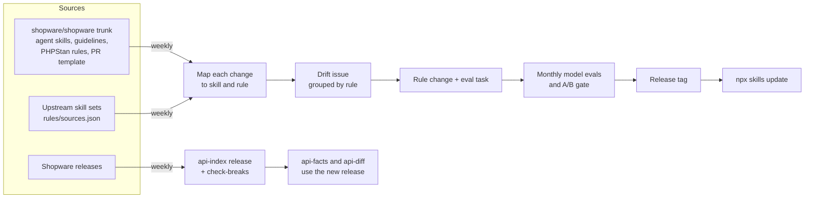

# Staying current

Shopware changes every week, so a rule that was right for 6.6 can be wrong
for 6.8. The library treats that as a maintenance job with automation, not a
one-time write-up.



## What runs today

| Job | When | What it does |
| --- | ---- | ------------ |
| Drift mining ([`mine-trunk.yml`](../.github/workflows/mine-trunk.yml)) | weekly | Reads every source in [`rules/sources.json`](../rules/sources.json) since its last pass, maps each change to the skill and rule it touches, and opens a `trunk-drift` issue grouped by skill and rule. A `/mined` comment from a member moves [`.mining-state.json`](.mining-state.json) forward for every source. |
| API index ([`api-index.yml`](../.github/workflows/api-index.yml)) | weekly | Rebuilds the public API index for every release since 6.5.0.0 plus trunk, publishes it as the `api-index` release asset, and runs `check-breaks` against the UPGRADE files. |
| Model evals ([`evals.yml`](../.github/workflows/evals.yml)) | monthly, on dispatch, or with the `run-evals` label | Runs the A/B for the eval tasks and fails the gate when a skill makes results worse. |
| Core PR watchlist | with each mining pass | Open core PRs that will change a rule, with a prepared branch where it pays off. See [`core-pr-17657-alignment.md`](core-pr-17657-alignment.md#watchlist). |
| `scripts/check-update.sh` | when you run it | Tells an installed project that a newer release exists. |

Running drift mining locally:

```bash
node tools/bin/mine-trunk.ts report                       # every source since its state
node tools/bin/mine-trunk.ts report --source shopware     # one source
node tools/bin/mine-trunk.ts report --since 2026-10-13 --until 2026-10-19
node tools/bin/mine-trunk.ts report --signals drift.jsonl # also write the mapped changes
```

The `/mined` pull request needs **Settings → Actions → General → Workflow
permissions → "Allow GitHub Actions to create and approve pull requests"**.

## Sources

The drift job reads the repositories in
[`rules/sources.json`](../rules/sources.json). Each one names the paths to
watch, how to read a commit, and which of our skills learn from which path.

| Source | What it reads | Our skills |
| ------ | ------------- | ---------- |
| `shopware` ([`shopware/shopware`](https://github.com/shopware/shopware) trunk) | Agent skill bullets, coding guideline headings, review guide rule IDs, PR template lines, PHPStan and Danger rule classes | By path: core's agent skills map to ours, the PR template to `sw-pr-description` |
| `ai-coding-tools` ([`shopwareLabs/ai-coding-tools`](https://github.com/shopwareLabs/ai-coding-tools)) | Markdown bullets and headings in the test-writing, contributor-writing, code-migration and dev-tooling plugins | `sw-testing`, `sw-pr-description`, `sw-plugin-development`, `sw-podman-dev` |
| `php-modernization` ([`netresearch/php-modernization-skill`](https://github.com/netresearch/php-modernization-skill)) | Markdown bullets and headings | `sw-php-foundation` |
| `shopware-cli` ([`shopware/shopware-cli`](https://github.com/shopware/shopware-cli)) | Markdown bullets and headings of its skills | `sw-podman-dev` |
| `fos-agent-skills` ([`FriendsOfShopware/agent-skills`](https://github.com/FriendsOfShopware/agent-skills)) | Markdown bullets and headings | `sw-testing`, `sw-admin-js` |

A dedicated PHPUnit skill joins once it exists.

To add a source:

1. Add an entry to `rules/sources.json`: `id`, `repo`, `branch`,
   `extractor` (`markdown` for a skill repository), the watched `paths`, and
   the `skills` per path. `validate-skills.sh` checks the file and the skill
   names.
2. Commit nothing else. The next report gives the new source a first pass
   that only records its branch head, and `/mined` stores it. Changes from
   then on show up in the weeks after.

A source `id` is a key in `.mining-state.json` and in the catalog, so it is
never renamed.

## Reading the drift issue

The issue opens with a table of sources: the day each one was read from,
how many commits touched a watched path, how many of those changed
something, and the commit the next pass starts after.

Then comes one section per skill. Inside it, each change sits under what it
touches, most specific first:

| Group | Matched by | What to do |
| ----- | ---------- | ---------- |
| A rule, `### TEST-016: …` | `core_guide_ids`, `enforced_by`, `trunk.source` or `upstream` in [`rules/catalog.json`](../rules/catalog.json) | Check the rule against the change: update it, retire it, or move it to "Already enforced by CI". |
| A reference, `` ### `references/…` `` | The skill's `routes.json`: an anchor on the changed line | Check the rules listed there; the change may concern one of them. |
| No rule yet | The source's skill list in `rules/sources.json` | A possible new rule for this skill, if it passes the inclusion criteria in the README. |

A change can appear under more than one rule when several cite the same
place. **Unmapped** lists changes no rule, route or source skill covers: a
new PHPStan rule class, or a guideline heading no rule cites. They are the
backlog for new rules. A modified rule class only appears when a rule cites
it, so small fixes to other checks stay out.

The **Commits** section lists, per source, the commits with a change, diffs
too large for the API, and the commits without one. Comment `/mined` once
every change is handled.

## Planned: review comments and drafted rules

Maintainer review comments on merged core PRs are the earliest place a
recurring pattern shows up; both rules in #55 came from there. A daily job
will collect them in the same format as the drift changes, and a local
command will suggest new, updated and retired rules and draft the pull
request. The plan, with measured volumes, is
[`plans/2026-10-skill-update-automation.md`](plans/2026-10-skill-update-automation.md).

## How a change lands

1. A drift issue, a review finding or a user report names the change. When
   a rule comes from trunk or an upstream skill set, record where in the
   catalog (`trunk.source` or `upstream`, as `path#heading-anchor`), so the
   next drift issue files changes there under the rule.
2. The rule changes in its one owning skill (see [`REGISTRY.md`](../REGISTRY.md)),
   with its ID and catalog entry.
3. An eval task proves it, or the catalog records why it cannot.
4. CI checks structure on every push. The model evals and the A/B gate run
   before a release.
5. Users get it with `npx skills update`.

Contributor details: [`AGENTS.md`](../AGENTS.md).
