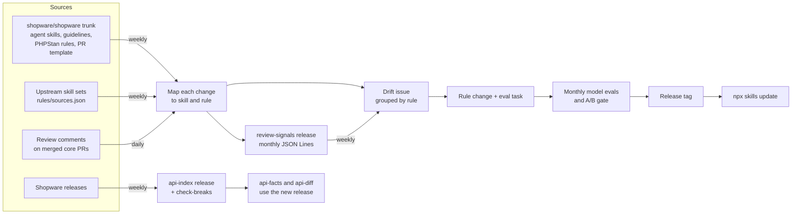

# Staying current

Shopware changes every week, so a rule that was right for 6.6 can be wrong
for 6.8. The library treats that as a maintenance job with automation, not a
one-time write-up.



## What runs today

| Job | When | What it does |
| --- | ---- | ------------ |
| Drift mining ([`mine-trunk.yml`](../.github/workflows/mine-trunk.yml)) | weekly | Reads every source in [`rules/sources.json`](../rules/sources.json) since its last pass, maps each change to the skill and rule it touches, and opens a `trunk-drift` issue grouped by skill and rule. A `/mined` comment from a member moves [`.mining-state.json`](.mining-state.json) forward for every source. |
| Review collector ([`collect-reviews.yml`](../.github/workflows/collect-reviews.yml)) | daily | Reads the review comments on PRs merged into `shopware/shopware` trunk since the last run, maps each to the skill and rule it touches, and publishes them as the `review-signals` release. See [Review comments](#review-comments). |
| API index ([`api-index.yml`](../.github/workflows/api-index.yml)) | weekly | Rebuilds the public API index for every release since 6.5.0.0 plus trunk, publishes it as the `api-index` release asset, and runs `check-breaks` against the UPGRADE files. |
| Model evals ([`evals.yml`](../.github/workflows/evals.yml)) | monthly, on dispatch, or with the `run-evals` label | Runs the A/B for the eval tasks and fails the gate when a skill makes results worse. |
| Core PR watchlist | with each mining pass | Open core PRs that will change a rule, with a prepared branch where it pays off. See [`core-pr-17657-alignment.md`](core-pr-17657-alignment.md#watchlist). |
| `scripts/check-update.sh` | when you run it | Tells an installed project that a newer release exists. |

Running drift mining locally:

```bash
node tools/bin/mine-trunk.ts report                       # every source since its state
node tools/bin/mine-trunk.ts report --source shopware     # one source
node tools/bin/mine-trunk.ts report --since 2026-10-13 --until 2026-10-19
node tools/bin/mine-trunk.ts report --signals drift.jsonl # also write the mapped changes
```

The `/mined` pull request needs **Settings → Actions → General → Workflow
permissions → "Allow GitHub Actions to create and approve pull requests"**.

## Sources

The drift job reads the repositories in
[`rules/sources.json`](../rules/sources.json). Each one names the paths to
watch, how to read a commit, and which of our skills learn from which path.

| Source | What it reads | Our skills |
| ------ | ------------- | ---------- |
| `shopware` ([`shopware/shopware`](https://github.com/shopware/shopware) trunk) | Agent skill bullets, coding guideline headings, review guide rule IDs, PR template lines, PHPStan and Danger rule classes | By path: core's agent skills map to ours, the PR template to `sw-pr-description` |
| `ai-coding-tools` ([`shopwareLabs/ai-coding-tools`](https://github.com/shopwareLabs/ai-coding-tools)) | Markdown bullets and headings in the test-writing, contributor-writing, code-migration and dev-tooling plugins | `sw-testing`, `sw-pr-description`, `sw-plugin-development`, `sw-podman-dev` |
| `php-modernization` ([`netresearch/php-modernization-skill`](https://github.com/netresearch/php-modernization-skill)) | Markdown bullets and headings | `sw-php-foundation` |
| `shopware-cli` ([`shopware/shopware-cli`](https://github.com/shopware/shopware-cli)) | Markdown bullets and headings of its skills | `sw-podman-dev` |
| `fos-agent-skills` ([`FriendsOfShopware/agent-skills`](https://github.com/FriendsOfShopware/agent-skills)) | Markdown bullets and headings | `sw-testing`, `sw-admin-js` |

A dedicated PHPUnit skill joins once it exists.

To add a source:

1. Add an entry to `rules/sources.json`: `id`, `repo`, `branch`,
   `extractor` (`markdown` for a skill repository), the watched `paths`, and
   the `skills` per path. `validate-skills.sh` checks the file and the skill
   names.
2. Commit nothing else. The next report gives the new source a first pass
   that only records its branch head, and `/mined` stores it. Changes from
   then on show up in the weeks after.

A source `id` is a key in `.mining-state.json` and in the catalog, so it is
never renamed.

## Reading the drift issue

The issue opens with a table of sources: the day each one was read from,
how many commits touched a watched path, how many of those changed
something, and the commit the next pass starts after.

Then comes one section per skill. Inside it, each change sits under what it
touches, most specific first:

| Group | Matched by | What to do |
| ----- | ---------- | ---------- |
| A rule, `### TEST-016: …` | `core_guide_ids`, `enforced_by`, `trunk.source` or `upstream` in [`rules/catalog.json`](../rules/catalog.json) | Check the rule against the change: update it, retire it, or move it to "Already enforced by CI". |
| A reference, `` ### `references/…` `` | The skill's `routes.json`: an anchor on the changed line | Check the rules listed there; the change may concern one of them. |
| No rule yet | The source's skill list in `rules/sources.json` | A possible new rule for this skill, if it passes the inclusion criteria in the README. |

A change can appear under more than one rule when several cite the same
place. **Unmapped** lists changes no rule, route or source skill covers: a
new PHPStan rule class, or a guideline heading no rule cites. They are the
backlog for new rules. A modified rule class only appears when a rule cites
it, so small fixes to other checks stay out.

**Review comments** counts the review comments on core PRs merged in the
week up to the report, per skill and reference, with how many went
outdated and links to the PRs. It reads the `review-signals` release and
maps the comments again with today's rules. Read the comments behind a busy
row in the release; a row that keeps coming back is a candidate for a rule.

The **Commits** section lists, per source, the commits with a change, diffs
too large for the API, and the commits without one. Comment `/mined` once
every change is handled. `/mined shopware php-modernization` moves only the
sources it names and leaves the issue open for the rest. A state only moves
to where the report ends, never back.

A new report closes an older open issue only when it reaches at least as
far in every source that issue lists. To see a report and what would happen
to the issues without writing anything, run the workflow by hand with
`dry_run`, or locally:

```bash
node tools/bin/mine-trunk.ts run --dry-run --repo OWNER/NAME
```

## Review comments

Maintainer review comments on merged PRs are the earliest place a recurring
pattern shows up; both rules in #55 came from there. The daily
[`collect-reviews.yml`](../.github/workflows/collect-reviews.yml) job runs
[`tools/bin/collect-reviews.ts`](../tools/bin/collect-reviews.ts) over the
review sources in [`rules/sources.json`](../rules/sources.json):

| Review source | Repository | Where it is collected |
| ------------- | ---------- | --------------------- |
| `core-reviews` | [`shopware/shopware`](https://github.com/shopware/shopware), PRs merged into `trunk` | Daily in CI, published as the `review-signals` release |
| `commercial-reviews` | `shopware/SwagCommercial` (private), PRs merged into `trunk` | Only on a maintainer's machine, into `.cache/review-signals/` |

**What it keeps.** The first comment of each review thread and each review
body, from anyone but bots and the PR's author, once it has at least 40
characters without `suggestion` blocks and HTML comments. Shorter ones are
mostly typo fixes or "nit". Replies are counted, not stored. Each signal
records whether its thread went outdated (the code under it changed later)
and the state of its review, such as `CHANGES_REQUESTED`. Resolved is not
stored: almost every thread on a merged PR is resolved.

**Who counts.** Every reviewer, not only org members. Trust comes from a
reviewer's record instead. `reviewers.json` lists, per reviewer, their
comments, how many went outdated, their reviews and PRs, and a trust score
from 0 to 1:

```text
trust = (outdated + 4 × prior) / (comments + 4)      prior: 0.5 for org members, 0.25 for everyone else
```

A new reviewer sits near the prior. After about ten comments their own
share of comments the code followed decides. A long-time contributor
outside the org can rank above a member, and a new employee starts no
higher than any other member. [`suggest-rules`](#suggesting-rule-changes)
weights comments by it.

**Where the data lives.** The release `review-signals` holds one asset per
source and month of merge, `core-reviews-2026-10.jsonl`, and
`reviewers.json`. The newest merge time in the assets is where the next run
starts, so there is no state file and no daily commit. Assets older than
twelve months are deleted. Each line is a signal in the format of
[`tools/src/signals.ts`](../tools/src/signals.ts), mapped like a drift
change. The comment text is there for analysis only: a rule drafted from it
is written in our own words and links the PR.

Download a month, or collect yourself:

```bash
gh release download review-signals --pattern 'core-reviews-2026-10.jsonl' --dir .cache/review-signals
node tools/bin/collect-reviews.ts                                  # every review source since the cache's newest merge
node tools/bin/collect-reviews.ts --source core-reviews --since 2026-09-01 --until 2026-10-20
node tools/bin/collect-reviews.ts --public --dir /tmp/review-signals   # what CI runs
```

Locally the collector uses `GH_TOKEN`, `GITHUB_TOKEN` or your `gh auth
login`. A private source needs a login that can read it.

**Private repositories stay private.** This repository is public, and so
are its releases and issues. A private review source is never collected in
GitHub Actions: the collector refuses it there, and the workflow passes
`--public`. The drift issue leaves private sources out even when a local
cache holds them. A rule that learns from a private review cites no
private PR in public text.

To add a review source, add an entry under `reviews` in
`rules/sources.json`: `id` (never renamed, and not the ID of a drift
source), `repo`, `base` and `private`. A public one is in the next daily
run. For a backfill, start the workflow by hand with `since` and `until`.

### Replaying the router

The review comments double as a test of the reference router.
[`tools/bin/replay-routes.ts`](../tools/bin/replay-routes.ts) takes every
PR with a review comment in `.cache/review-signals/`, fetches its diff once
into `.cache/pr-diffs/`, runs the router on it and compares the result with
the references the comments map to:

- **Recall**: the share of comment-mapped references the router selects
  for the whole PR. A comment maps through the same routes on its own hunk,
  so a miss means the code under the comment left the merged diff (the
  thread went outdated, or the file was dropped) or a route excludes the
  path.
- **Noise**: references selected per PR with no comment mapped to them,
  overall and per reference.

```bash
node tools/bin/replay-routes.ts --out /tmp/replay.md
node tools/bin/replay-routes.ts --root ../branch-checkout --focus sw-testing/references/test-shape-and-flags.md
node tools/bin/replay-routes.ts --corpus evals/routing-replay
node tools/bin/replay-routes.ts --record evals/routing-replay --pr 20734 --pr 19917@1f0c407f74d8
```

`--root` replays another checkout's routes on the same signals and diffs,
so a route change can be measured before it merges. `evals/routing-replay/`
is a small recorded corpus of public core PRs: trimmed diffs (file headers,
every line an anchor matches, a few other changed lines) and the
comment-mapped references at recording time. `N@SHA` records the diff at
the commit a comment was written on, for a comment whose code was removed
before the merge. Hand `labels` in `case.json` name the reference a
comment needed, as ground truth independent of the routes.
`tools/test/route-replay.test.ts` checks the corpus offline against a
recall floor, a noise ceiling and every hand label. Never record a private
review source; the bin refuses it.

## Suggesting rule changes

[`tools/bin/suggest-rules.ts`](../tools/bin/suggest-rules.ts) turns the
review signals and the open drift issue into proposals: a new rule, an
update, a retirement, or "already covered". It runs locally with the agent
you are logged in to and writes `suggestions/<date>.md` and `.json`. The
folder is git-ignored, because a proposal can quote a private review.

```bash
node tools/bin/suggest-rules.ts --since 2026-09-01 --source core-reviews
node tools/bin/suggest-rules.ts --since 30d --skill sw-testing
node tools/bin/suggest-rules.ts --signals ./reviews.jsonl --agent opencode --offline
```

| Option | Default | What it does |
| ------ | ------- | ------------ |
| `--since` | `30d` | Start of the window, `YYYY-MM-DD` or a number of days |
| `--until` | today | End of the window |
| `--skill` | every skill | Ask only the clusters of one skill |
| `--signals FILE` | | Read these signals (JSON Lines) instead of the cache and the drift issue |
| `--source ID` | every source | Review sources from `.cache/review-signals/`; repeat for more |
| `--agent` | `claude` | `claude`, `opencode`, or a command that reads the prompt on stdin |
| `--offline` | off | Neither download release assets nor read the drift issue |
| `--out DIR` | `suggestions/` | Where the files go |
| `--api-index FILE` | `$API_INDEX`, then the user cache | The API timeline for the retirement check |
| `--baseline FILE` | newest `evals/baselines/*.jsonl` | The A/B results for the retirement check |
| `--continue FILE` | | An earlier `suggestions/<date>.json`: ask only the clusters it did not, in its window |

`SUGGEST_MAX_CLUSTERS` (20) caps the agent calls, `SUGGEST_MAX_SIGNALS` (25)
the signals quoted per cluster, `SUGGEST_MODEL` (`haiku` for claude) picks
the model. The run prints the token use.

**A second pass.** The clusters over the cap are not lost. Continue the
run, and it asks the next ones and writes one result with both:

```bash
SUGGEST_MAX_CLUSTERS=40 node tools/bin/suggest-rules.ts --continue suggestions/2026-10-23.json --source core-reviews
```

The window comes from the earlier run, and new IDs follow its last one.
On the same day the result replaces the earlier file, which it contains.

**What happens, in order.**

1. The `review-signals` assets of the window that are newer than the cache
   are downloaded, and the open `trunk-drift` issue is read. Every signal
   is mapped again with today's routes.
2. Signals are clustered without a model: by the rule or reference they map
   to, and unmapped ones by file area (`Core/Checkout`). A cluster with one
   signal is dropped unless its review requested changes. A signal weighs
   its reviewer's trust from `reviewers.json`, times 1.5 when its thread went
   outdated and again when the review requested changes. Clusters are asked
   in order of weight; the rest are listed under "Over the cap".
3. Retirement candidates come first, found without a model:
   - an `enforced_by` check whose `extensions_run` proves that plugins and
     apps run it with no setup of their own. Not being `trunk_only` is not
     enough: `phpstan-deprecation-rules` runs only where a plugin installs
     it, and `CompletionGuard` only under Shopware's `TestBootstrapper`;
   - every class the rule names is gone from the API index in the supported
     releases (`SUGGEST_SUPPORTED_FROM`, 6.6.0.0);
   - the rule's eval task passed every repeat with the skill off in the
     latest A/B baseline.
4. The agent gets one prompt per cluster: the signals as quoted data it must
   not follow, the current text of the rules the cluster maps to, up to
   eight more rules the signals share words with (a keyword match, so an
   unmapped comment on a history comment still meets `REV-034`), the topics each
   skill owns, and the inclusion criteria from the README. The claude
   adapter runs with no tools, no MCP servers and no tokens in its
   environment.
5. The answer must match the JSON schema in the plan, at most three
   proposals per cluster. Then each proposal goes through checks that need
   no model: every evidence URL was in the prompt, the skill owns a topic in
   [`REGISTRY.md`](../REGISTRY.md), an update or retirement names an active
   rule of that skill (`none` may name one of any skill), and a new rule has
   comments from at least two PRs or a review that requested changes.
6. The proposals that passed are ranked, without a model. A proposal
   scores its evidence once per PR, at the heaviest signal of that PR, so
   several PRs and trusted reviewers beat one long thread. The score
   halves when the rule is for core only (its `audience`, else the skill's
   `metadata.contexts`), because this library is for extension developers
   too. It halves again when a higher proposal of the same skill shares
   most of its words (`overlaps` names that one). The table at the top of
   the file is in rank order; draft from the top.

**Reading a proposal.** Each one has an ID (`2026-10-23-04`), the action,
skill and rule, the draft text, the eval it needs, the evidence links, the
agent's answer per criterion and the result of every check. A failed check
marks the proposal; it is still listed, so you can see what the agent got
wrong. Judge a passing one against the five criteria yourself:

- **Delta**: would a model get this wrong without the rule? A comment that
  repeats a PHPStan error is not a delta.
- **Value**: do the comments come from several PRs and reviewers, or one
  long thread? `frequency` in the answer should say which.
- **Single home**: does the proposal fit the owning skill, or does it
  restate a rule elsewhere? `none` with a rule ID is the right answer for a
  cluster the rules already cover.
- **Testable**: is the eval concrete enough to write a catch and an ignore
  diff?
- **License-clean**: the draft is in our words and links the PR, never
  quotes it.

For a retirement, open the evidence: the CI check's source and whether it
runs for extensions, the release the class left, or the A/B row. Retiring
moves the rule to `retired` in the catalog and removes it from the skill
text. To have the agent write the change, see
[Drafting a proposal](#drafting-a-proposal).

## Drafting a proposal

```bash
node tools/bin/suggest-rules.ts draft 2026-10-23-04 --no-pr   # branch and worktree only
node tools/bin/suggest-rules.ts draft 2026-10-23-04           # and a draft PR
```

`draft` takes a proposal ID from `suggestions/` that passed its checks and
is not `none`:

1. It creates the branch `rules/<skill>-<slug>` from `--base` (`main`) in a
   worktree under `.cache/drafts/`.
2. The agent makes the change by the steps in `AGENTS.md`: for a new rule
   the next free ID, the catalog entry and an eval task with golden
   fixtures; for an update the new text; for a retirement the catalog
   status and the removed bullet. It gets the proposal, not the review
   comments. Claude runs with file tools and `Bash` limited to `node`,
   `npm` scripts and the repo's own scripts, with no web tools, no MCP
   servers and no GitHub or package token.
3. The generators `AGENTS.md` names (`render-routes`, `render-enforced`,
   `render-router-index`) and `npm run format` run, then the free checks CI
   runs on every push:
   `validate-skills.sh`, the tools type check, lint and tests, the golden
   graders and Markdown lint. On a failure the agent gets the output once
   more; when the checks still fail, the command stops and leaves the
   worktree for you.
4. It commits, then runs `eval-local` for the eval tasks the change adds or
   edits, plus an updated rule's own task (`DRAFT_REPEATS`, default 3).
   The results go to `suggestions/<id>-ab.jsonl`.
5. It writes the PR body to `suggestions/<id>-pr.md`: the evidence links,
   the criteria answers, the free checks and the A/B table, row by row
   from the results file. Without `--no-pr` it pushes the branch and opens
   a draft PR with the `run-evals` label, so CI repeats the A/B. A proposal
   with private evidence never gets a PR.

`DRAFT_MODEL` (`haiku`), `DRAFT_MAX_TURNS` (60) and `DRAFT_MAX_BUDGET_USD`
(2) bound the agent. Remove a kept worktree with `git worktree remove`.

## How a change lands

1. A drift issue, a review finding or a user report names the change. When
   a rule comes from trunk or an upstream skill set, record where in the
   catalog (`trunk.source` or `upstream`, as `path#heading-anchor`), so the
   next drift issue files changes there under the rule.
2. The rule changes in its one owning skill (see [`REGISTRY.md`](../REGISTRY.md)),
   with its ID and catalog entry. Either you write it, or `suggest-rules`
   proposes it and `suggest-rules draft` writes it into a draft PR.
3. An eval task proves it, or the catalog records why it cannot.
4. CI checks structure on every push. The model evals and the A/B gate run
   before a release; a drafted PR has the `run-evals` label, so they run
   on it too.
5. Before merging a drafted PR, read it like any other: does the rule pass
   the five criteria, is it in our words, does the eval's `fixtures/fail/`
   come close to passing, and does the skill win the A/B? A draft the
   skill does not win stays a draft.
6. Users get it with `npx skills update`.

Contributor details: [`AGENTS.md`](../AGENTS.md).
