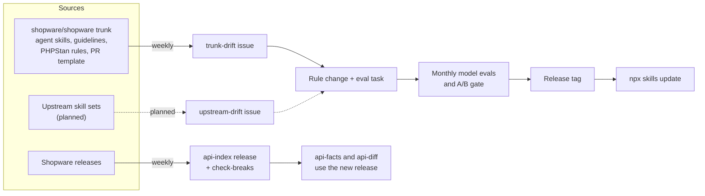

# Staying current

Shopware changes every week, so a rule that was right for 6.6 can be wrong
for 6.8. The library treats that as a maintenance job with automation, not a
one-time write-up.



## What runs today

| Job | When | What it does |
| --- | ---- | ------------ |
| Trunk mining ([`mine-trunk.yml`](../.github/workflows/mine-trunk.yml)) | weekly | Opens a `trunk-drift` issue with what changed on `shopware/shopware` trunk since the last pass: agent skill bullets, coding guidelines, PHPStan rules that `rules/catalog.json` cites, and the PR template. A `/mined` comment from a member moves [`.mining-state.json`](.mining-state.json) forward. |
| API index ([`api-index.yml`](../.github/workflows/api-index.yml)) | weekly | Rebuilds the public API index for every release since 6.5.0.0 plus trunk, publishes it as the `api-index` release asset, and runs `check-breaks` against the UPGRADE files. |
| Model evals ([`evals.yml`](../.github/workflows/evals.yml)) | monthly, on dispatch, or with the `run-evals` label | Runs the A/B for the eval tasks and fails the gate when a skill makes results worse. |
| Core PR watchlist | with each mining pass | Open core PRs that will change a rule, with a prepared branch where it pays off. See [`core-pr-17657-alignment.md`](core-pr-17657-alignment.md#watchlist). |
| `scripts/check-update.sh` | when you run it | Tells an installed project that a newer release exists. |

Running trunk mining locally:

```bash
node tools/bin/mine-trunk.ts report
```

The `/mined` pull request needs **Settings → Actions → General → Workflow
permissions → "Allow GitHub Actions to create and approve pull requests"**.

## Planned: upstream skill sets

The same weekly-issue pattern will watch the skill sets this library learns
from. A change there becomes a question for us: does a rule we own need an
update, or is there a new finding worth a rule and an eval?

| Source | Why we watch it |
| ------ | --------------- |
| [`shopwareLabs/ai-coding-tools`](https://github.com/shopwareLabs/ai-coding-tools) | Test-writing rules, PR and commit skills, and the dev-tooling MCP servers our skills point at. |
| [`netresearch/php-modernization-skill`](https://github.com/netresearch/php-modernization-skill) | PHP 8.x modernization patterns behind `sw-php-foundation`. |
| [`shopware/shopware-cli`](https://github.com/shopware/shopware-cli) skills | Project and extension workflows `sw-podman-dev` hands off to. |
| [`FriendsOfShopware/agent-skills`](https://github.com/FriendsOfShopware/agent-skills) | Plugin PHPUnit patterns linked from `sw-testing`. |
| A dedicated PHPUnit skill | Planned. Generic PHPUnit practice that `sw-testing` can defer to, the way it defers to core on trunk. |

Nothing here is built yet. It reuses the trunk mining pieces: a state file
per source, a report of what changed since then, and an issue that closes
when a member marks it mined.

## How a change lands

1. A drift issue, a review finding or a user report names the change.
2. The rule changes in its one owning skill (see [`REGISTRY.md`](../REGISTRY.md)),
   with its ID and catalog entry.
3. An eval task proves it, or the catalog records why it cannot.
4. CI checks structure on every push. The model evals and the A/B gate run
   before a release.
5. Users get it with `npx skills update`.

Contributor details: [`AGENTS.md`](../AGENTS.md).
