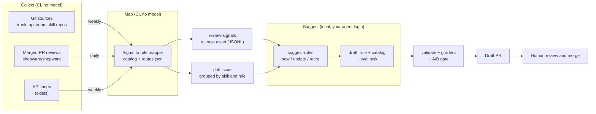

# Skill update automation plan (2026-10)

Status: **accepted** (2026-10-23); phase 0 done, phases 1 and 2 in progress · Author: BrocksiNet · Created: 2026-10-23

Rules go stale because Shopware changes every week. Half of the upkeep is
automated already: the weekly trunk mining issue and the weekly API index.
A person still reads each drift issue, finds the rule it touches, and writes
the change and its eval. This plan automates the reading and the drafting.
The merge stays human, and every rule change still has to pass the A/B gate.

It extends [WP8](2026-10-skills-evolution.md#wp8-automated-trunk-mining) and
[WP9](2026-10-skills-evolution.md#wp9-upstream-watchlist) of the skills
evolution plan, and builds the "Planned: upstream skill sets" part of the
maintenance page (`docs/maintenance.md`, added in #54).

## Why now

Both rules in #55 (`REV-034`, `REV-035`) came from maintainer review comments
on merged core PRs (#19917, #20855). No guideline file and no agent skill on
trunk carried them, so trunk mining could not have found them. Review
comments are the earliest place a recurring pattern shows up. Today nobody
collects them.

## How the pieces fit



Four layers, each usable without the next one:

| Layer | Runs | Model cost | Output |
| ----- | ---- | ---------- | ------ |
| Collect | CI, weekly and daily | none | Normalized **signals**: one changed line, rule class or review comment each |
| Map | CI, inside the collectors | none | Each signal tagged with the skills, references and rule IDs it touches |
| Suggest | Local command | your agent plan | Proposals: new rule, rule update, or retirement, each with evidence links |
| Draft | Local command, later CI on a label | your agent plan | A draft PR with rule text, catalog entry and eval task, gated by the A/B |

The cheap, deterministic layers come first. They pay off on their own: the
drift issue gets shorter and names the rule to look at. The model layers only
read data the deterministic layers already filtered and mapped.

## The signal format

Every collector writes the same JSON Lines record, so the mapper, the issue
renderer and the suggest command share one parser in `tools/src/signals.ts`.

```json
{
  "id": "shopware/shopware#19917/review-comment/1834455012",
  "source": "core-reviews",
  "kind": "review-comment",
  "repo": "shopware/shopware",
  "url": "https://github.com/shopware/shopware/pull/19917#discussion_r1834455012",
  "date": "2026-10-14T09:12:00Z",
  "pr": { "number": 19917, "title": "…", "merged_at": "2026-10-16T11:02:00Z" },
  "author": { "login": "dgrothaus", "association": "MEMBER" },
  "path": "src/Core/Content/Category/Service/CategoryBreadcrumbBuilder.php",
  "diff_hunk": "@@ -120,6 +120,14 @@ …",
  "text": "This docblock describes what the PR changed, not what the code does …",
  "thread": { "replies": 1, "outdated": true },
  "map": [
    { "skill": "sw-review-learnings", "reference": "references/code-comments.md", "rules": ["REV-034"], "via": "anchors_any" }
  ]
}
```

Kinds: `skill-bullet`, `guideline-heading`, `guide-id`, `rule-class`,
`template-line` (today's trunk deltas), `upstream-line` (an upstream skill
repo), `review-comment`, `review-body`, and `api-break` (from `check-breaks`).
The `id` is stable, so a re-run never duplicates a signal.

## Phase 0 results (2026-10-23)

Measured over PRs merged into `shopware/shopware` trunk from 2026-09-01 to
2026-10-22, with a one-off script outside the repo:

| Measure | Count |
| ------- | ----- |
| Merged PRs | 709 |
| Review threads | 1207 |
| Threads started by a maintainer, not the PR author, not a bot | 994 |
| Of those, at least 40 characters without suggestion blocks | 799 |
| Of those, outdated (the code changed after the comment) | 513 |
| Merged PRs with at least one kept thread | 245 |
| Maintainer review bodies of at least 40 characters | 139 |

What this changes:

- **Volume is small.** About 15 kept threads a day, from about 20
  reviewers. Storage and API limits are not a concern.
- **Resolved means nothing.** Almost every thread on a merged PR is
  resolved, so the collector does not store it.
- **Outdated is a weight, not a filter.** Keeping only outdated threads
  would leave 43%, but it drops the `REV-035` source: the blocking Dynamic
  Access finding on #19917 was answered in another file and never went
  outdated. The suggest step weights outdated threads higher instead.
- **Both #55 sources are in the data.** #20855 (merged 2026-10-13) and
  #19917 (merged 2026-10-20) carry the comments behind `REV-034` and
  `REV-035`, so the step 3 backfill acceptance holds.
- **About a fifth of kept threads end in a question.** They stay. A
  question that leads to a code change is often the finding.

## Step 1: one mining job, many sources

Generalize `tools/bin/mine-trunk.ts` from one hard-coded repo to a source
list. The trunk extractors in `tools/src/trunk-deltas.ts` stay as they are;
upstream repos get a generic Markdown extractor (bullets and headings).

**Source list**: `rules/sources.json`, one entry per source:

```json
{
  "id": "ai-coding-tools",
  "repo": "shopwareLabs/ai-coding-tools",
  "branch": "main",
  "paths": ["plugins/test-writing", "plugins/contributor-writing"],
  "extractor": "markdown",
  "skills": ["sw-testing", "sw-pr-description"]
}
```

First sources: `shopware/shopware` (today's `WATCHED` paths),
`shopwareLabs/ai-coding-tools`, `netresearch/php-modernization-skill`,
`shopware/shopware-cli` skills and `FriendsOfShopware/agent-skills`. The
PHPUnit skill joins once it exists. `skills` names the skills that learn
from the source, so a change there is mapped even without a catalog link.

**State**: `docs/.mining-state.json` becomes a map from source ID to
`{last_sha, last_date}`. The current object migrates to the `shopware`
entry. A new source starts at its head on the day it is added.

**Issue**: one weekly `trunk-drift` issue stays, with a section per source.
Rename the label to `drift` only if the trunk section gets lost among the
others. The state marker in the body records every source, so one `/mined`
comment still moves all of them, and never past unread deltas.

**Acceptance**:

- The 2026-10-13..2026-10-19 window still reports the eight commits WP8
  reported. The tests in `tools/test/mine-trunk.test.ts` pass unchanged.
- A stubbed upstream commit that adds a bullet shows up under its source.
- `rules/sources.json` has a schema and `validate-skills.sh` checks it.

## Step 2: map each change to a rule

A new mapper, `tools/src/map-signal.ts`, tags each signal with the skills,
references and rule IDs it touches. It uses only data the repo already has,
in this order, and records which one matched in `via`:

1. **`core_guide_ids`**: a guide ID in the signal matches a rule's IDs.
2. **`enforced_by.tool`**: a rule class matches a check a rule cites.
3. **`trunk.source`**: the signal's file and heading match a rule's
   `path#anchor`. Today only some rules have it; the report lists rules
   whose source changed.
4. **`upstream`**: a new optional catalog field, the upstream counterpart of
   `trunk.source`, for rules learned from an upstream skill.
5. **`routes.json`**: the signal's path and diff lines run through
   `routeDiff()` from `tools/src/routes.ts`. A review comment on a file the
   cache route selects maps to the cache reference and the rules in it.
6. **`sources.json` `skills`**: the fallback for an upstream change no rule
   cites yet.

A signal with no match is **unmapped**. Unmapped signals are the backlog for
new rules; mapped ones are candidates for an update.

**Issue layout**: the drift issue groups signals by skill, then by rule:

```markdown
## sw-testing
### TEST-014 (via enforced_by)
- `NoExpectExceptionMessageRule` modified in [1a2b3c4d](…)
### Unmapped
- New bullet in `.agents/skills/sw-testing/SKILL.md`: "…" ([5e6f7a8b](…))
```

**Acceptance**:

- Every existing report item lands under a skill. Items that used to be
  listed flat appear under the rule `core_guide_ids` or `enforced_by` names.
- A routing test: the #19917 docblock comment maps to `REV-034` through
  `anchors_any` (fixture under `tools/test/fixtures/signals/`).
- The catalog schema has `upstream`, and `validate-rules` accepts it.

## Step 3: collect merged-PR reviews daily

A daily workflow, `.github/workflows/collect-reviews.yml`, runs
`tools/bin/collect-reviews.ts`. It reads the PRs merged into
`shopware/shopware` trunk since the last run and turns their review comments
into signals. No model calls and no secrets beyond `GITHUB_TOKEN`.

**What it reads**: one GraphQL search for PRs merged into trunk since the
cursor (`is:pr is:merged base:trunk merged:>…`), 25 PRs per page. Each page
brings the review threads with their first comment, `path`, `isOutdated`
and the comment count, and the review bodies. Phase 0 needed about 30
queries for 52 days, so a daily run is one or two queries.

**What it keeps**:

- Authors with `author_association` `MEMBER` or `OWNER`, minus bots and the
  PR's own author. A maintainer team list can replace this later.
- Thread starters only. Replies are counted in `thread.replies`, not stored.
- `thread.outdated`: the diff under the comment changed later, so the author
  most likely acted on it. It is a weight for the suggest step, not a filter:
  the blocking finding behind `REV-035` was never outdated.
- Review bodies of at least 40 characters, as kind `review-body`.
- It drops thread starters under 40 characters once `suggestion` blocks and
  HTML comments are removed. Most of them are typo fixes or "nit".

**Where the data lives**: a release named `review-signals`, like the
`api-index` release, with one asset per month (`reviews-2026-10.jsonl`).
The daily job downloads the current month, appends new signals by `id`, and
uploads it again. The newest `merged_at` in the asset is the cursor, so
there is no state file in the repo and no daily commit. Assets older than
twelve months are deleted.

**Why not commit the data**: a daily commit to `main` would bury real
changes, and the comments are public on GitHub anyway. The release keeps
them machine-readable and one download away for the local command.

**Content rules**: a signal stores the comment text for analysis only.
Skills never quote it. A rule drafted from it is written in our own words,
like everything else in the library, and links the PR as its source.

**Acceptance**:

- A backfill run over 2026-09-01..2026-10-20 contains the #19917 and #20855
  comments behind `REV-034` and `REV-035`, mapped to those rules.
- A daily run makes at most a few GraphQL queries and keeps what the
  phase 0 filter keeps: about 15 signals a day.
- The GitHub API is stubbed in `tools/test/collect-reviews.test.ts`.

## Step 4: suggest rules with a local command

`node tools/bin/suggest-rules.ts` reads signals and proposes changes. It runs
on your machine with the agent you are logged in to, through the adapters in
`tools/src/agents.ts`, the same way `eval-local.ts` does. It costs your
plan's usage, not an API key.

```bash
node tools/bin/suggest-rules.ts --since 2026-09-01            # all sources
node tools/bin/suggest-rules.ts --since 30d --skill sw-testing
node tools/bin/suggest-rules.ts --signals ./reviews-2026-10.jsonl --agent opencode
```

**Pipeline**:

1. **Load** the `review-signals` assets for the window and the open drift
   issue. Both are already mapped.
2. **Cluster without a model**: group by mapped reference, then by file area
   (the first two path segments under `src/`). Drop clusters of one signal
   unless the review requested changes.
3. **Ask the agent per cluster**, with the signals as quoted data, the
   mapped rules' current text, and the five inclusion criteria from the
   README. The answer must match a JSON schema:

   ```json
   {
     "action": "new | update | retire | none",
     "skill": "sw-review-learnings",
     "rule": "REV-034",
     "title": "Comments describe the code, not its history",
     "evidence": ["https://github.com/shopware/shopware/pull/19917#discussion_r…"],
     "criteria": { "delta": "…", "frequency": "…", "single_home": "…", "testable": "…" },
     "draft": "One paragraph of rule text in our words",
     "eval": { "kind": "review-pair | task", "catch": "…", "ignore": "…" }
   }
   ```

4. **Check without a model**: `rule` exists for `update` and `retire`, the
   skill owns the topic in `REGISTRY.md`, every evidence URL is in the input
   signals, and a `new` rule has at least two PRs as evidence or one review
   that requested changes.
5. **Write** `suggestions/<date>.md` (git-ignored) and the JSON next to it.
   Nothing is committed.

**Retirement candidates** come from deterministic evidence first, and the
agent only explains them:

- a new `enforced_by` check now catches the rule in plugins too
  (`trunk_only: false`), so it moves to the "Already enforced" section
- the API index says the symbol the rule is about is gone in every
  supported version
- the latest A/B shows the skill-off arm already passes the rule's task in
  every repeat, so the delta principle no longer holds

**Acceptance**:

- Run on the backfill from step 3, it proposes `REV-034` and `REV-035` as
  covered (`none` or `update`), not as new rules.
- An evidence URL that is not in the input fails the check, tested with the
  fake agent from `tools/bin/fake-agent.ts`.
- A run over 30 days with a typical volume stays under a set number of agent
  calls (`SUGGEST_MAX_CLUSTERS`, default 20).

## Step 5: draft the pull request

`node tools/bin/suggest-rules.ts draft <suggestion-id>` turns one accepted
proposal into a draft PR:

1. Create a worktree and a branch `rules/<skill>-<slug>`.
2. Ask the agent to make the change by the steps in `AGENTS.md`: the rule in
   its owning file with the next free ID, the catalog entry, activation
   prompts, and the eval task with golden `fixtures/pass/` and an
   almost-pass `fixtures/fail/`. For a retirement: the catalog status, the
   removed text, and the eval task kept or retired.
3. Run the free checks: `validate-skills.sh`, the tools tests, the golden
   graders and Markdown lint. On a failure, give the agent the output once
   more, then stop and report.
4. Run the A/B with `eval-local.ts` for the new or changed tasks.
5. Open a draft PR with the evidence links, the criteria answers and the A/B
   table. Add the `run-evals` label so CI repeats the A/B.

You review and merge. Nothing merges on its own, and a draft whose A/B the
skill does not win stays a draft.

**Later**: the same command in a workflow, started by a `/draft <id>`
comment on the drift issue. It waits until the local command has drafted
enough good PRs to trust it.

**Acceptance**:

- A drafted PR passes every free check without manual edits for at least
  three of five proposals from the backfill.
- The A/B table in the PR body matches the `eval-local` results file.

## Safety and cost

- **Untrusted input.** Review comments and upstream files are text from
  other people. The agent sees them as quoted data in the prompt, never as
  instructions. The draft step runs in a worktree with edit and test tools
  only, without network access or tokens.
- **No silent changes.** CI never edits skills. Only the local command
  writes rule text, and only into a draft PR.
- **Cost.** Steps 1 to 3 need no model. Steps 4 and 5 use your agent plan
  and are capped per run. The daily collector makes one or two GraphQL
  queries.
- **License.** Upstream and review text informs a rule; it is never copied
  into one. CC-BY-SA sources stay rewrite-only, as `REGISTRY.md` says.

## Order and size

| Phase | Work | Depends on | Size | Model cost |
| ----- | ---- | ---------- | ---- | ---------- |
| 0 | Measure: count maintainer review comments on trunk for September and October 2026, and how many pass the noise filter | none | S | none |
| 1 | Source list and per-source state | none | M | none |
| 2 | Signal format and mapper; drift issue grouped by rule | 1 | M | none |
| 3 | Daily review collector and the `review-signals` release | 2 | M | none |
| 4 | `suggest-rules` command | 3 | M | local |
| 5 | `suggest-rules draft` | 4 | L | local |

Each phase includes its documentation; see [Documentation](#documentation).

Phases 1 and 2 can ship in one release. Phase 0 decides the filter
thresholds of phase 3 before any code is written.

## Documentation

A phase is done only when its docs describe what was built, not what was
planned. Each phase updates the docs in the same pull request as the code:

| Phase | Docs to update |
| ----- | -------------- |
| 1 | `docs/maintenance.md`: the "Planned: upstream skill sets" section becomes "What runs today", with the source list and how to add a source. README "Trunk mining" paragraph: one job, many sources. |
| 2 | `docs/maintenance.md`: how to read the drift issue grouped by skill and rule, and what "unmapped" means. `AGENTS.md`: fill `upstream` or `trunk.source` when adding a rule, so the mapper finds it. `rules/catalog.schema.json` describes `upstream`. |
| 3 | `docs/maintenance.md`: the review collector, what it keeps and drops, where the `review-signals` release is, and how to download a month. The flowchart gets the daily path. |
| 4 | A new section "Suggesting rule changes" in `docs/maintenance.md`: the command, its options, the proposal format, how to judge a proposal against the five criteria, and the retirement evidence. `AGENTS.md` "Repository layout" and "Adding or changing a rule" point to it. |
| 5 | `docs/maintenance.md` "How a change lands": the drafted-PR path next to the manual one, the checks it runs, and what a reviewer looks at before merging. `AGENTS.md` lists the draft command. |

After phase 5, `docs/maintenance.md` explains the whole process end to end
in one place: sources, signals, mapping, suggestions, drafts, gate and
merge. This plan then gets status **done** and links to that page instead
of repeating it.

## Open questions

1. **Storage.** A `review-signals` release asset (proposed) or an orphan
   data branch with one commit per day. The release matches `api-index`;
   the branch keeps history in git.
2. **Who counts as a maintainer.** `MEMBER` and `OWNER` is simple but
   includes everyone in the org. A list of reviewers per area is more
   precise and has to be kept up to date.
3. **More review sources.** Start with `shopware/shopware` only, or also
   `shopware/shopware-cli` and `shopware/frontends`.
4. **One issue or one per source.** One issue keeps one `/mined` comment.
   Separate issues let different people own different sources.
