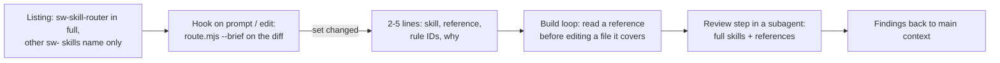

# Slim skill context plan (2026-10)

Status: **proposed** · Author: BrocksiNet · Created: 2026-10-30

Token usage went up, and the question was whether our skills cause it. They
do not: in two weeks of real sessions our skills were well under 1% of all
input tokens. The listing of our skill descriptions costs more than the
skills we actually load, because it rides along on every request.

The goal still holds: keep only the router in context all the time and
load the rest when a change or a review needs it. This plan measures first,
then slims the listing, then makes routing automatic, so no step trades
fewer tokens for skills the agent forgets to load.

## What we measured

`node tools/bin/skill-context.ts` reads the Claude Code transcripts under
`~/.claude/projects` (subagents included) and counts three things:

- **Listing:** our lines in the skill listing Claude Code sends on every
  request (name plus description).
- **Bodies:** the `SKILL.md` text Claude Code adds when a skill is invoked.
- **Files:** references, a `SKILL.md` or the router output the agent read
  with `Read` or a shell command.

A body or a file stays in context until the next compaction, so it is
counted once per request that carries it. Sizes are characters / 4.

Last 14 days on the author's machine (2026-10-16 to 2026-10-30, eval runs
left out):

| | Tokens | Share of input |
| --- | ---: | ---: |
| All input, every request | 3,584M | 100% |
| Our skill listing | 14.3M | 0.40% |
| Our skill bodies and files | 2.6M | 0.07% |

Per project, our share peaked at 2.4% in a plugin repository
(`SwagAgenticCommerce`) and 1.3% in the core checkout. 18 of 135 sessions
loaded one of our skills at all. A typical load is 500 to 2,500 tokens; the
router output is about 550.

What did fill the context, estimated the same way:

| Source | Share of input |
| --- | ---: |
| Shell command output | ~15% |
| Project instruction files (`AGENTS.md`, `CLAUDE.md`) | ~11% |
| File reads | ~8% |

One project alone loads a 60K-token `AGENTS.md` on every request. Long
sessions are the multiplier: many sessions peak near 266K tokens per
request. 97% of input tokens were cache reads, which cost a
fraction of uncached input; the per-request numbers still count against
rate limits.

## How skills reach the context today

| Piece | When it loads | How long it stays | Size today |
| --- | --- | --- | --- |
| Description in the listing | Every request, from the start | Whole session | ~2,600 tokens for all 19 skills, ~1,500 for a core install |
| `SKILL.md` body | When the agent invokes the skill | Until compaction; afterwards re-attached, max 5K per skill, 25K in total | 600 to 3,000 tokens |
| Reference | When the agent reads it | Until compaction | 100 to 3,000 tokens |
| Router output | When the agent runs `route.mjs` | Until compaction | ~550 tokens |

Claude Code caps the whole listing at 1% of the context window. When more
skills are installed than fit, it drops descriptions of the least used
skills first, so a long description of ours can push out another skill's
trigger words, and the other way round. Source:
[Claude Code skills docs](https://code.claude.com/docs/en/skills).

## What others do

- **Compressed index instead of a decision.** Vercel's Next.js evals got
  100% with an 8KB docs index in `AGENTS.md` and at most 79% with a skill,
  because the agent never has to decide to look something up
  ([Vercel, 2026-01](https://vercel.com/blog/agents-md-outperforms-skills-in-our-agent-evals)).
  Their index is a list of pointers, not the docs themselves.
- **Hook-driven activation.** Community setups run a `UserPromptSubmit`
  hook that matches the prompt or changed files against rules and injects
  "use skill X" before the model sees the prompt
  ([claudefa.st](https://claudefa.st/blog/tools/hooks/skill-activation-hook)).
  Matching is code, so it costs no listing tokens and does not depend on
  the model noticing a description.
- **Listing control.** Claude Code's `skillOverrides` setting can show a
  skill as `"name-only"`, and `disable-model-invocation: true` removes the
  description from context entirely. `/doctor` and `/context` report what
  the listing costs.
- **Review in a subagent.** `context: fork` runs a skill in a fresh
  subagent with the skill as its prompt; only the result comes back to the
  main conversation.

## Design: router first, load late

The router already knows which skill and reference a change needs: it reads
the diff and `index.json`. The agent only has to run it. So the always-on
part shrinks to the router, and everything else loads because a file or a
task asked for it.

### Phase 1: measure (this change)

`tools/bin/skill-context.ts` with tests. Run it before and after each phase;
the A/B eval transcripts give the same numbers per task.

### Phase 2: slim the listing

- Shorten every description to the trigger words that decide activation,
  about 300 characters, and move the rest into the body. Today they are
  290 to 930 characters.
- Add an install profile where only `sw-skill-router` (and `sw-help`) keep
  a full description and the other skills are `"name-only"` through
  `skillOverrides`, documented in `use-cases/`.
- Gate: the activation evals and the A/B suite must not lose activations.
  Earlier Haiku runs skipped skills until descriptions said "load before any
  edit", so this is the step most likely to regress.

Saves 1,500 to 2,600 tokens on every request and frees the shared listing
budget for other skills.

### Phase 3: route without a decision

- `route.mjs --brief`: the matched skills, the references with their rule
  IDs and one-line titles, and why each matched. No skill bodies. The index
  gets the rule titles from `rules/catalog.json` at render time.
- `route.mjs --hook`: the same, but prints nothing when the set did not
  change since the last call (state in the git dir), so it can run on every
  prompt or after edits without repeating itself.
- Ship the hook wiring as a settings snippet in `use-cases/` first; a
  Claude Code plugin later, since `npx skills add` installs skills only.
- Gate: routing cases in `evals/routing/` and the replay corpus keep their
  recall floor; A/B pass rate equal or better with fewer tokens per task.

This is the Vercel lesson applied to our layout: a short index of pointers
that arrives without the agent choosing to look.

### Phase 4: load the full rules at review time

- The "check this change against the skills" step runs as a subagent:
  `sw-extension-review` and `sw-pr-review` get a forked variant, and the
  router can print a ready subagent prompt for a build task.
- The build loop keeps only the brief index and the references it read on
  purpose. The full skill text lives in the subagent and is gone after it
  returns.
- Risk: code written without the rules needs more fixes afterwards. The
  rule IDs from phase 3 are the guard; the A/B suite decides.

### Phase 5: smaller bodies

`sw-core-development`, `sw-extension-review` and `sw-podman-dev` are near
3,000 tokens each. Move detail into references behind routes and lower the
`SKILL.md` budget in `validate-skills.ts` from 500 lines to a token budget.

## Not part of this plan

The biggest savings are outside this repository: oversized instruction
files, very long sessions, and verbose command output. They belong in each
project's own setup; the measuring tool shows them too when run with
`--json` per session.

## Open questions

- Does `"name-only"` keep activation on Haiku and Sonnet, or does the hook
  have to come first?
- Should the hook also fire after `Edit`/`Write` (new files join the
  change), or is prompt time enough?
- Codex and Cursor have no hooks with the same shape; they keep the current
  listing until there is an equivalent.
